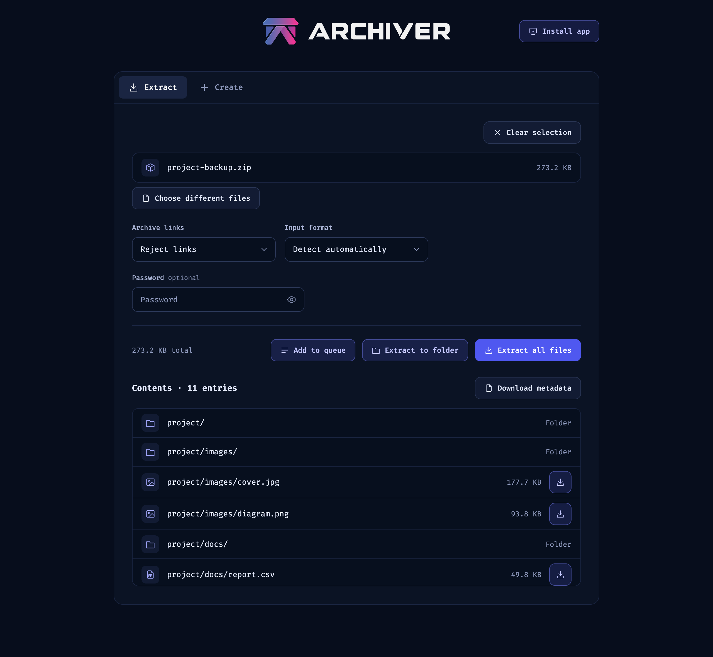

<p align="center">
  <a href="https://archiver.scryer.media"></a>
</p>

<p align="center">
  Free archive tool that runs in your browser.<br>
  Open, create and repair archives without installing anything. Your files never leave your device.
</p>

<p align="center">
  <a href="https://archiver.scryer.media"><b>archiver.scryer.media</b></a>
</p>

<p align="center">
  
</p>

## Features

- **Open** ZIP, 7z, RAR (including solid and RAR5), TAR, GZ, XZ, BZ2, Zstandard, Brotli, LZMA, LZ4 and ISO disc images
- **Split and protected archives**: `.part1.rar`, `.001` sets and password-protected files
- **Create** ZIP, 7z and TAR (plain or compressed), with AES-256 encryption for ZIP and 7z
- **Repair** with PAR2 and PAR3 recovery files and RAR recovery volumes, and add PAR2 recovery data to new archives
- **No size limit** beyond your free disk space
- **Works offline** once installed as an app

## Privacy

Everything runs locally in WebAssembly. There is no server-side processing, no account and no analytics. The [Content Security Policy](public/_headers) blocks requests to any other site, so files have nowhere to go. You can confirm it in your browser's developer tools: the Network tab shows no uploads.

## Development

Requires Node.js 22.18 or newer.

```sh
npm ci
npm run dev     # local dev server
npm run check   # type check and tests
npm run build   # production build in dist/
```

The archive engine is Rust compiled to WebAssembly. A prebuilt copy is committed in `public/engine/`, so you only need to rebuild it after changing `engine/`. That needs Rust with the `wasm32-unknown-emscripten` target, Emscripten, CMake and Python:

```sh
sh engine/build.sh
```

All Rust dependencies are pinned to exact crates.io versions in `engine/Cargo.toml`. The build downloads a pinned libarchive release and checks its hash.

## Issues

Found a bug or an archive that won't open? [Open an issue](https://github.com/scryer-media/archiver/issues). Please report security problems privately through [GitHub's security advisories](https://github.com/scryer-media/archiver/security/advisories/new).

## License

[Apache-2.0](LICENSE). Third-party license texts are in `engine/licenses/` and `public/licenses/`. The RAR reader is based on unRAR, whose license allows extracting RAR files but not creating them.
